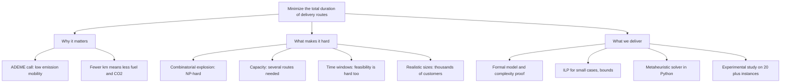

# Problem mapping

The class [exploration sheet](./exploration-sheet.md), analyzed: what exactly we must decide,
under which rules, what is in and out of scope, how we will know we succeeded, and what could go
wrong. This page is the reference when a scope question comes up later.

## 1. Problem statement

**Original (class):** How can we minimize the total duration of the delivery route using a
well-structured algorithm with the lowest complexity possible?

**Refined:** Given a depot, a set of customers with known demands and a fleet of identical trucks
of capacity Q, find a set of routes, each starting and ending at the depot, that **serves every
customer exactly once**, **never exceeds the truck capacity** and, at Level A, **starts each
delivery inside the customer's time window**, so that the **total travel duration is minimal**.
Since the problem is NP-hard, "lowest complexity possible" becomes: an exact method for small
instances and a polynomial time per iteration metaheuristic that reaches a gap below 7 percent on
reference instances of realistic size.

Why the refinement: the original wording mixes the objective (minimize duration) with a property
of the method (low complexity). Separating them avoids promising something impossible (an exact
polynomial algorithm) and gives a measurable target instead.

## 2. Who is involved

| Stakeholder | Interest | What they need from us |
| --- | --- | --- |
| **ADEME** (funder) | Measurable reduction of energy use and emissions | A credible, quantified method and its limits |
| **CesiCDP management** (client in the scenario) | A winning, deliverable proposal in 5 weeks | Results oriented presentation, honest status |
| **Delivery operators** (end users) | Feasible routes they can actually drive | Routes that respect capacity and time windows |
| **Customers** (served) | Delivery inside their window | No late delivery (hard constraint at Level A) |
| **Tutor** (CESI) | Rigor in modeling, method and statistics | Valid proof, consistent ILP, justified experiments |
| **Team** (Pablo, Dag, Farida) | A good grade, learning OR | A clear split of work, see [Task separation](../task-separation.md) |

## 3. The decision

| | Content |
| --- | --- |
| **Inputs** | Depot location; n customers with location and demand q_i; travel times between every pair of nodes; k trucks of capacity Q; at Level A, window [e_i, l_i] and service time s_i per customer |
| **Decision** | How many trucks to use, which customers each truck serves, and in which order |
| **Output** | A list of routes (depot, customers, depot), their total duration, and the schedule (arrival, wait, service start) at Level A |
| **Objective** | Minimize the sum of travel durations of all routes |

## 4. Constraints, classified

Each constraint from the class sheet, translated into one of six categories. Every item lands in
exactly one category.

| From the class sheet | Interpretation | Category | Where it is handled |
| --- | --- | --- | --- |
| visit all clients only once (if possible) | Each customer is served by exactly one visit; no split deliveries. "If possible" is resolved by the guarantee that q_i is at most Q, so it is always possible. | **Hard constraint** | ILP degree constraints; `Solution.violations` |
| truck size and capacity | Load of a route is at most Q; homogeneous fleet | **Hard constraint** | MTZ load constraints; capacity checks |
| time windows | Service starts in [e_i, l_i]; early arrival waits | **Hard constraint** (Level A) | big-M time constraints; `timewindows.py` |
| duration and distance | Objective is duration; with constant speed it is proportional to distance | **Objective** | c_ij = travel time |
| fuel or electricity | Energy is roughly proportional to distance, so minimizing duration already reduces it | **Objective** (indirect) | discussed, not modeled separately |
| topology | The road network is summarized by a complete graph of shortest path travel times | **Modeling assumption** | [Modeling](../technical/modeling.md) |
| size of the problem | Up to several thousand customers for CVRP | **Method requirement** | metaheuristic, granular neighborhoods |
| lowest complexity | Low time complexity per iteration; empirical scaling measured | **Method requirement** | complexity analysis and time scaling |
| accuracy / optimal solution | Exact for small n; gap below 7 percent to best known otherwise | **Method requirement** | ILP and gap metric |
| use Python | Python 3.11, numpy vectorized | **Method requirement** | `src/cvrp/` |
| test the algorithm on at least 20 different instances | At least 20 instances from different scenarios | **Method requirement** | [Instances](../experimentation/instances.md) |
| emergencies | Urgent orders arriving during the day | **Out of scope** | dynamic VRP; named as a future improvement |

## 5. Scope

| In scope | Extension if time allows | Out of scope |
| --- | --- | --- |
| CVRP, homogeneous fleet, single depot (Level B) | Traffic per time slot (time dependent travel times) | Emergencies and dynamic re-routing |
| CVRPTW with waiting allowed (Level A) | Fleet size minimization as a second objective | Multiple depots, heterogeneous fleet |
| ILP for small instances, LP lower bound | Rounded capacity cuts | Split deliveries, pickups and returns |
| ALNS metaheuristic, SA baseline | numba acceleration | Real road network data and map APIs |
| Study on 20 plus VRPLIB and synthetic instances | | Driver regulations, breaks |

## 6. Assumptions

1. Travel time is deterministic and symmetric: c_ij = c_ji, computed from coordinates (Euclidean),
   rounded as each benchmark set requires.
2. The triangle inequality holds (shortest path times), so visiting a customer twice is never
   useful.
3. Every demand fits in one truck (q_i at most Q), so a feasible solution always exists for CVRP
   with enough trucks.
4. The fleet is homogeneous; at Level B its size k is either fixed by the instance name (CVRPLIB
   `-k` suffix) or free.
5. At Level A, service times are known and a truck may wait at a customer until the window opens;
   the depot window bounds the working day.
6. The objective is total travel duration; waiting time is not counted in the objective (Solomon
   convention). *To confirm with the tutor.*

## 7. Success criteria

| Criterion | Target | Measured in |
| --- | --- | --- |
| Solution quality | Mean gap to best known **below 7 percent** on VRPLIB CVRP instances (above 7 to 10 percent caps the grade at B) | [Results](../experimentation/results.md) |
| Exactness | ILP optimal on every instance with n up to 12 to 15; metaheuristic matches it | final notebook section 4 |
| Scale | CVRP instances with **1000 plus customers** solved within the time budget | time scaling figure |
| Robustness | 10 seeds per instance; report mean, standard deviation, best | experimental design |
| Feasibility | 100 percent of reported solutions pass `Solution.violations` | results CSV `feasible` column |
| Rigor | Statistical tests stated with hypotheses, alpha and correction | notebook 03 |
| Communication | Presentation in English with live demo under one minute | [Presentation plan](../delivery/presentation-plan.md) |

## 8. What we must learn

| Knowledge gap | Lane | Starting point |
| --- | --- | --- |
| Polynomial reductions and NP-hardness proofs | Person 1 | Garey and Johnson; [Complexity](../technical/complexity.md) |
| VRP formulations (two-index, MTZ, capacity cuts, time windows) | Person 1 | Toth and Vigo, chapters 1 and 5 (to verify) |
| PuLP and CBC: modeling, time limits, reading bounds | Person 1 | PuLP documentation |
| Local search operators and their deltas | Person 2 | [Metaheuristic](../technical/metaheuristic.md) |
| ALNS and simulated annealing | Person 2 | Ropke and Pisinger (2006) |
| Time window feasibility in O(1) | Person 2 | Savelsbergh (1992) |
| VRPLIB formats and best known solutions | Person 3 | `vrplib` documentation, CVRPLIB |
| Comparing algorithms statistically | Person 3 | Demsar (2006); [Experimental design](../experimentation/experimental-design.md) |

## 9. Risks

| Risk | Likelihood | Impact | Mitigation | Owner |
| --- | --- | --- | --- | --- |
| Gap above 7 percent on large X instances | medium | grade capped at B | granular neighborhoods, more operators, tuning; report per size honestly | Person 2 |
| ILP does not solve beyond n = 12 | high | weak exact section | that is an expected result; show bounds and the time curve | Person 1 |
| Python too slow for thousands of customers | medium | cannot show scale | numpy vectorization, neighbor lists, numba | Person 2 |
| Instance downloads or best known values wrong | low | wrong gaps | cross-check two sources; record URLs | Person 3 |
| Tutor rejects the complexity proof | low | rework in week 3 | draft early (week 1), show it at the modeling check | Person 1 |
| Lanes drift apart, integration late | medium | broken final notebook | API frozen in week 1; CI on every pull request; weekly meeting | all |
| Level A not reached | medium | lower ceiling, not failure | Level B complete first; CVRPTW added incrementally | Person 2 |

## 10. Action plan

The prosit action plan, turned into owned tasks:

1. Research the theory (complexity, formulations, metaheuristics): Person 1 and Person 2, week 1.
2. Write the formal model and the complexity proof, then the ILP: Person 1, weeks 1 to 2.
3. Validate the model with the tutor (modeling deliverable): Person 1, week 2.
4. Choose and implement the metaheuristic: Person 2, weeks 1 to 4.
5. Gather 20 plus instances and design the experiments: Person 3, weeks 1 to 2.
6. Run the campaign and analyze it: Person 3, week 4.
7. Assemble the final notebook and present: everyone, week 5.

Full detail: [Task separation](../task-separation.md) and [Schedule](../management/schedule.md).
