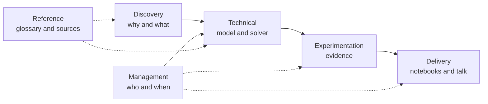

# CVRP Metaheuristics

**Shorter delivery routes for the ADEME smart mobility call.** CesiCDP (our fictional
organization) proposes a route optimizer for delivery fleets: given a depot, a set of customers
with demands and a fleet of identical trucks, compute the routes that serve every customer and
minimize the total route duration.

This repository holds everything for the CESI module *Algorithms and Combinatorial Optimization*:
the formal model, the complexity proof, the ILP, a Python metaheuristic solver, the benchmarks and
the statistical study, plus this documentation.

**Team:** Pablo, Dag and Farida. Work is split into three lanes (Person 1, Person 2, Person 3),
described in [Task separation](./task-separation.md).

## The problem in one paragraph

A truck leaves the depot, visits a subset of customers without exceeding its capacity, and comes
back. Several trucks share the work. We want the set of routes with the lowest total duration.
This is the **Capacitated Vehicle Routing Problem (CVRP)**, our expected scope (Level B). The
advanced scope (Level A) adds a **time window** per customer: delivery is forbidden outside it,
and a truck that arrives early waits. That is the **CVRPTW**.

## Status today

:::info[Scaffold, not a finished project]
The repository is set up so the three of us can start in parallel. What runs today: instance
loading, solution checks, nearest neighbor, 2-opt, relocate, a basic ALNS loop, the benchmark
harness and the analysis script, with 21 passing tests. Everything else is a marked `TODO(Person N)`.
See [Architecture](./technical/architecture.md) for the module by module status.

:::

## How this documentation is organized

Two entry pages, then six folders. Each folder answers one question and no page answers two, so
anything new has exactly one place to go.

| Folder | The question it answers | Pages |
| --- | --- | --- |
| **Discovery** | Why are we doing this, and what exactly is the problem? | context, exploration sheet, problem mapping |
| **Technical** | How do we model and solve it? | modeling, complexity, ILP, metaheuristic, architecture |
| **Experimentation** | How do we prove the solver is good? | instances, experimental design, results |
| **Delivery** | What do we hand in, and how is it graded? | deliverables, checklist, presentation plan |
| **Management** | How do the three of us work, and when? | kickoff meeting, working agreements, schedule |
| **Reference** | Which words and sources do we look up? | glossary, bibliography |



## Where the code lives

| Path | Content |
| --- | --- |
| `src/cvrp/` | The solver package (instance, solution, constructions, neighborhoods, ALNS, SA, ILP, time windows, plots) |
| `tests/` | Unit tests and the end to end smoke test |
| `experiments/` | `run_benchmark.py`, `analyze.py` and `config.yaml` |
| `notebooks/` | The three Jupyter deliverables: modeling check, final deliverable, experimental study |
| `data/` | Downloaded VRPLIB and Solomon instances (not committed; see `data/README.md`) |
| `results/` | CSV outputs and figures (not committed; regenerated by `make benchmark`) |
| `docs/` | This site |

## Quick start

```bash
python3.11 -m venv .venv && source .venv/bin/activate
make install      # pip install -e ".[dev]"
make test         # 21 tests, includes the smoke test
make benchmark    # synthetic instances work offline; VRPLIB ones once downloaded
make analyze      # tables, figures and statistical tests in results/
make docs         # this site on http://localhost:3000
```
