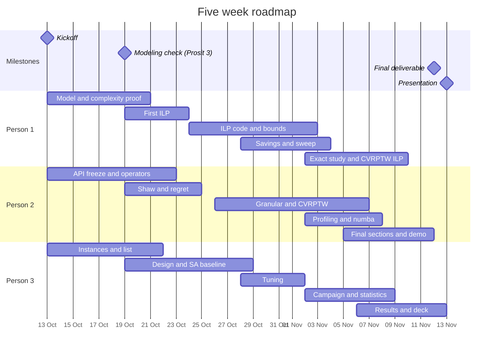

# Schedule

Five weeks, from the kickoff on **13 October 2026** to the ADEME submission. Dates of the modeling
check and of the presentation are **assumptions to confirm** at kickoff (D9).

## Week by week

| Week | Dates | Goal | Done when |
| --- | --- | --- | --- |
| 1 | 13 to 18 Oct | Lanes assigned; model and proof drafted; API frozen; instances downloaded | kickoff decisions closed; notation and proof drafts reviewed |
| 2 | 19 to 25 Oct | **Modeling deliverable**; new operators; instance list and design final | tutor check passed; 20 plus instances in `config.yaml` |
| 3 | 26 Oct to 1 Nov | ILP running on small n; ALNS complete for CVRP; first gaps on A and X | gap table for A instances in the weekly meeting |
| 4 | 2 to 8 Nov | Scaling and CVRPTW; full campaign; statistics | `results/` complete; notebook 03 draft |
| 5 | 9 to 13 Nov | Final notebook, deck, rehearsal | final deliverable handed in; presentation given |

## Final sprint, 10 to 13 November

**Focus: improve, not rebuild.** The three solvers and the final notebook work. After the
professor's review of 10 November we run new datasets through them (large synthetic, real cities of
France and Egypt), study the parameters, and write our own analysis. Everything is finished on
**11 November at night**; 12 November is hand in, rehearsal and buffer.

| # | Request of the professor | What we do |
| --- | --- | --- |
| R1 | At least 10 000 customers | 1k, 2k, 5k with seeds, then confirm at 10k |
| R2 | Synthetic or random graphs | uniform, clustered, random graph (NetworkX) |
| R3 | Real data, OpenStreetMap, NetworkX | real road network and real customer locations |
| R4 | France against Egypt | Lyon and Cairo (proposal), same n, same protocol, network metrics, traffic profile |
| R5 | Performance against intrinsic parameters | sensitivity curves per parameter |
| R6 | Our own analysis per scenario | scenario table, one analysis paragraph per author |
| R7 | No code in the presentation | slides with mathematics, figures, tables |
| R8 | The limit of each algorithm | time per iteration, memory and gap against n |
| R9 | What happens during the night | departure at 8:00 against 22:00 with the real traffic profile |

**Small first, then large.** The professor added that an algorithm whose loop works on a small
scenario works on a large one: the logic does not depend on n. The cost does (time per iteration,
memory, iterations within the budget, hence quality). So we debug at 1 000, measure 1k, 2k, 5k with
seeds, fit how time grows with n, and confirm with a few 10 000 runs.

### Real data

| Data | France (Lyon) | Egypt (Cairo) |
| --- | --- | --- |
| Road network | OpenStreetMap drive network (osmnx), same area in both | same |
| Customers | real shops, supermarkets, pharmacies (OpenStreetMap); SIRENE as a second source | real shops, supermarkets, pharmacies (OpenStreetMap) |
| Travel times | shortest paths on the road network | same |
| Traffic by hour | TomTom Traffic Index | TomTom Traffic Index |

Demands and capacity follow the same rule in both cities; sources go in `data/real/SOURCES.md`.

### Timeline

| When | Who | What |
| --- | --- | --- |
| 10 Nov 11:00 | all | 30 min call |
| 10 Nov 11:30 to 14:00 | Pablo | harness: generators, road matrix, `experiments/scale_study.py` reusing the solvers |
| 10 Nov 11:30 to 14:00 | Farida | real data of Lyon and Cairo, traffic profiles, sources |
| 10 Nov 11:30 to 16:00 | Dag, Pablo | sensitivity of their own algorithm |
| 10 Nov 14:00 to 18:00 | Farida | sensitivity of GRASP-ILS, network metrics |
| 10 Nov 16:00 to 19:00 | all | new datasets through their own algorithm: 1 000, then one run at 10 000 |
| 10 Nov 16:00 to 20:00 | Pablo | night experiment |
| 10 Nov 20:00 | all | freeze |
| 10 Nov 21:00 to 11 Nov 07:00 | Pablo's M2 | overnight campaign |
| 11 Nov 09:00 | all | results meeting, scenario table |
| 11 Nov 09:00 to 12:00 | Dag, Farida | analysis paragraph and figures of their own algorithm, sent to Pablo |
| 11 Nov 09:00 to 13:00 | Pablo | final notebook and docs |
| 11 Nov 12:00 to 17:00 | Pablo | deck, no code |
| 11 Nov 17:00 | all | professor agent review, fixes |
| 11 Nov 20:00 | all | rehearsal 1 |
| 12 Nov | all | hand in, rehearsal 2, buffer |

### Tasks

| Task | Pablo (Tabu Search) | Dag (SA) | Farida (GRASP-ILS) |
| --- | --- | --- | --- |
| Sensitivity (10 Nov 16:00, Farida 18:00) | tenure, candidate list, neighbor list | $f$, $T_f$ | $\alpha$, kicks, kick size |
| New datasets (10 Nov 19:00) | 1k, then once 10k | 1k, then once 10k | 1k, then once 10k |
| Analysis (11 Nov 12:00) | half a page and figures | half a page and figures | half a page and figures |
| Specific | harness, night, campaign, notebook, deck | | real data, network metrics |

Sensitivity rule: one factor at a time around the tuned value, the 6 tuning instances, 3 seeds,
20 s per run, mean gap with its spread, one sentence per curve, one behavior measure.

### Overnight campaign protocol

| Item | Value |
| --- | --- |
| Synthetic | uniform and clustered: 1 000, 2 000, 5 000 (3 seeds), 10 000 (1 seed) |
| Real | Lyon and Cairo: 1 000 and 5 000 (3 seeds), 10 000 if enough real customers (1 seed) |
| Best known value | Belgium set: Leuven1 (3 000), Ghent1 (10 000) |
| Budget | 0.06 s per customer, the same for every algorithm |
| Metric | gap to the best known value, else deviation to the best of any run; time per iteration; peak memory |
| Parallel | 7 runs below 5 000 customers, 3 above (8 GB of RAM) |
| Tests | Friedman, then Wilcoxon with Holm |

### Scenario recommendation (to fill on 11 November, 09:00)

| Scenario | Recommended | Why (number from our data) |
| --- | --- | --- |
| up to 8 customers, with traffic | exact ILP | proves the optimum |
| 100 customers, clustered, tight windows | | |
| 100 customers, random or mixed, long routes | | |
| 1 000 to 10 000 customers | | |
| real roads, France | | |
| real roads, Egypt | | |
| short time budget | | |
| night departure | | |

### Definition of done

- Every new table or figure has one sentence that says what it means.
- Every claim of the analysis cites a number of this project.
- The professor agent (`.claude/agents/professor.md`) returns no BLOCKING item.

## Weekly log

*Appended after each weekly meeting by the scribe.*

| Week | Done | Blocked | Decisions |
| --- | --- | --- | --- |
| 1 | | | |
| 2 | | | |
| 3 | | | |
| 4 | | | |
| 5 | | | |
