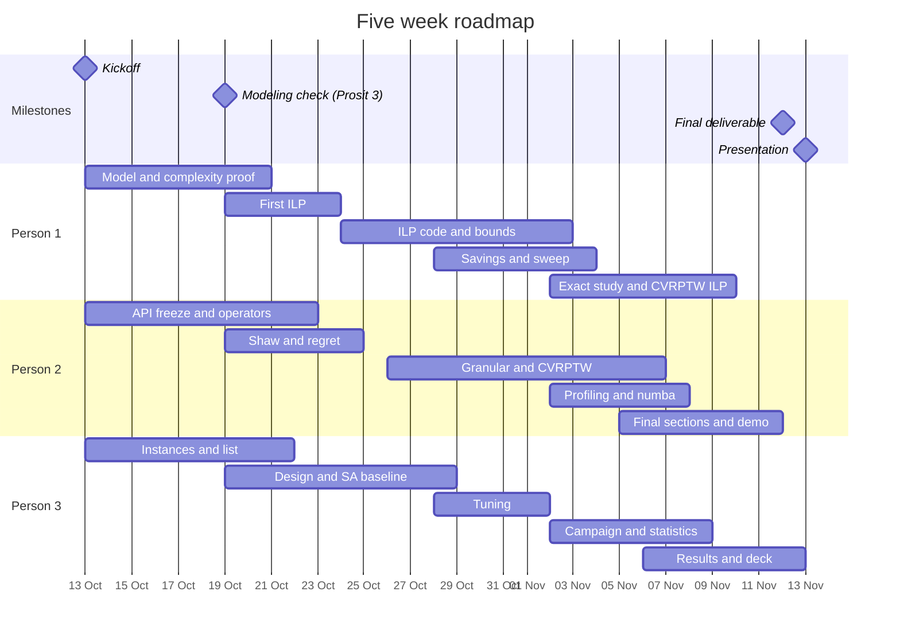
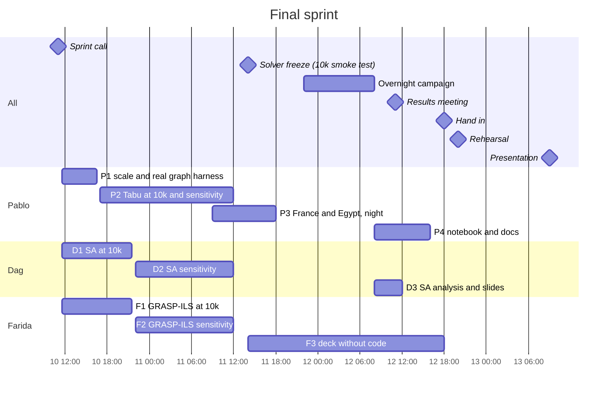

# Schedule

Five weeks, from the kickoff on **13 October 2026** to the ADEME submission. Dates of the modeling
check and of the presentation are **assumptions to confirm** at kickoff (D9).

## Week by week

| Week | Dates | Goal | Done when |
| --- | --- | --- | --- |
| 1 | 13 to 18 Oct | Lanes assigned; model and proof drafted; API frozen; instances downloaded | kickoff decisions closed; notation and proof drafts reviewed |
| 2 | 19 to 25 Oct | **Modeling deliverable**; new operators; instance list and design final | tutor check passed; 20 plus instances in `config.yaml` |
| 3 | 26 Oct to 1 Nov | ILP running on small n; ALNS complete for CVRP; first gaps on A and X | gap table for A instances in the weekly meeting |
| 4 | 2 to 8 Nov | Scaling and CVRPTW; full campaign; statistics | `results/` complete; notebook 03 draft |
| 5 | 9 to 13 Nov | Final notebook, deck, rehearsal | final deliverable handed in; presentation given |

## Final sprint, 10 to 13 November

The professor reviewed our progress on **10 November** (notes taken by Pablo). What he asks, and
what we have now:

| # | Request | Have now | Gap to close |
| --- | --- | --- | --- |
| R1 | At least **10 000 customers** | 100 (Solomon), 31 (A, B) | scale study up to 10 000 |
| R2 | Synthetic or random graphs | uniform generator only | uniform, clustered, random graph |
| R3 | **Real graphs**: OpenStreetMap, NetworkX | none | road network travel times |
| R4 | Compare two countries, **France and Egypt**: why better in one, why in the other | none | same protocol in both, network metrics, explanation |
| R5 | Performance against **intrinsic parameters** (as pheromones for Ant Colony), "to the maximum" | one tuning grid per algorithm | sensitivity curves per parameter, behavior measures |
| R6 | **Our own analysis and opinion**: which algorithm in every scenario | one winner overall | recommendation per scenario, written by us |
| R7 | **No code** in the presentation | deck not started | slides with mathematics, figures, conclusions |
| R8 | Real world shows the **limit** of the algorithm: understand it | 100 customers only | largest n that works, time, memory, where quality breaks |
| R9 | **What happens during the night?** | traffic factor 1 at night, 48 h horizon | night against morning departure, with numbers |

R9 has two readings: the traffic at night (our reading), or what an algorithm gains when it runs
all night. The plan covers both (task P3 and the long runs of A3); Pablo confirms with the
professor.

### Deadlines

The hand in hour (18:00) and the presentation hour are **to confirm**.

### Tasks and deliverables

Each person keeps their lane: the harness is shared, each algorithm is made to scale and studied
by its author.

| ID | Owner | Task | Deliverable | Due |
| --- | --- | --- | --- | --- |
| A1 | all | 30 min call: agree this plan, the cities, the time budgets | decisions in the weekly log | 10 Nov 11:00 |
| P1 | Pablo | Instance builders: uniform and clustered points, random graph (NetworkX), OpenStreetMap city (osmnx), travel time matrix by shortest paths (scipy), network metrics; loader for the Belgium set (CVRPLIB); `experiments/scale_study.py` with the `ALGORITHMS` hook; matrices saved as `.npy` and memory mapped (8 GB of RAM: a 10 000 matrix is 800 MB) | `src/cvrp/graphs.py`, `experiments/scale_study.py`, a smoke test at n = 1 000 that anyone runs with one command | 10 Nov 16:30 |
| D1 | Dag | SA runs at n = 1 000, 2 000, 5 000, 10 000 on the P1 instances: no per iteration work in O(n²), read only matrix | SA plugged into `ALGORITHMS`; table of n, time per iteration, peak memory, largest n that works | 10 Nov 22:00 |
| F1 | Farida | GRASP-ILS at the same sizes: the regret construction is the expected bottleneck (granular insertion candidates) | GRASP-ILS plugged into `ALGORITHMS`; the same table | 10 Nov 22:00 |
| P2 | Pablo | Tabu Search at the same sizes; sensitivity of tenure, candidate list size, neighbor list size | the same table; sensitivity CSV and curves | 11 Nov 12:00 |
| D2 | Dag | SA sensitivity: start factor $f$, final temperature $T_f$, move probabilities; acceptance rate against time | CSV and curves, one sentence each | 11 Nov 12:00 |
| F2 | Farida | GRASP-ILS sensitivity: $\alpha$ from 0 to 1, number of kicks (0 to 250), kick size, neighbor list size; iterations against $\alpha$ | CSV and curves, one sentence each | 11 Nov 12:00 |
| A2 | all | Freeze: each algorithm finishes the 10 000 smoke test in its budget | the three commits merged in `Dev_Pablo` | 11 Nov 14:00 |
| P3 | Pablo | France and Egypt: one city each (proposal: Lyon and Cairo), same area and same n; network metrics table; an hourly traffic profile per city; the night: same customers, departure at 8:00 against 22:00, duration objective, exact on small n and metaheuristics on large n | instances in `data/osm/`, metrics table, night table | 11 Nov 18:00 |
| A3 | all (Pablo's M2) | Overnight campaign, protocol below; plus one long run per algorithm on the 10 000 instance (convergence over hours) | `results/scale_benchmark.csv`, `results/long_runs.csv` | 12 Nov 08:00 |
| A4 | all | Results meeting: read the tables, write the scenario recommendation together; each author writes the analysis of their algorithm in their own words | scenario table, three analysis paragraphs | 12 Nov 11:00 |
| D3 | Dag | SA slides (no code) and its analysis paragraph | slides in the deck | 12 Nov 12:00 |
| P4 | Pablo | Final notebook: new sections on scale and real world, sensitivity, scenario recommendation; sections 4, 8 and 9 updated; docs mirrored; professor agent review | `notebooks/02_final_deliverable.ipynb` executed, docs build | 12 Nov 16:00 |
| F3 | Farida | Deck without code: context, model, complexity, exact limit, methods, Solomon results, scale and real world, sensitivity, scenario recommendation, limits, next steps | deck (PDF) | 12 Nov 16:00 |
| A5 | all | Hand in | notebook, deck, repository tag | 12 Nov 18:00 |
| A6 | all | Rehearsal, timed, and a question drill (night, limits, France and Egypt, why GRASP-ILS) | timing per speaker | 12 Nov 20:00 |

### Scale campaign protocol (A3)

| Item | Value |
| --- | --- |
| Problem | CVRP (capacity) with travel times; duration with traffic for the night study only |
| Synthetic | uniform and clustered points, n = 1 000, 2 000, 5 000, 10 000 |
| Real roads | France and Egypt cities, n = 1 000, 5 000, 10 000 customers on road nodes |
| With best known value | Belgium set: Leuven1 (3 000), Antwerp1 (6 000), Ghent1 (10 000) |
| Budget | 0.06 s per customer: 60 s at 1 000, 600 s at 10 000, the same for every algorithm |
| Seeds | 3 (5 if the night allows) |
| Metric | gap to the best known value (Belgium); elsewhere deviation to the best solution of any run; time to the first feasible solution; peak memory |
| Parallel | 7 runs below 5 000 customers, 3 at 5 000 and above (memory) |
| Tests | Friedman, then Wilcoxon with Holm, as in section 8 |
| Size | about 13 worker hours for 3 seeds: about 3.5 h of wall clock |

### Scenario recommendation (to fill on 12 November, A4)

| Scenario | Recommended | Why (number from our data) |
| --- | --- | --- |
| up to 8 customers, with traffic | exact ILP | |
| 100 customers, clustered, tight windows | | |
| 100 customers, random or mixed, long routes (type 2) | | |
| 1 000 to 10 000 customers | | |
| real road network, France | | |
| real road network, Egypt | | |
| short time budget | | |
| night departure | | |

### Definition of done

- Every new table or figure has one sentence that says what it means.
- Every claim of the analysis cites a number of this project.
- The professor agent (`.claude/agents/professor.md`) returns no BLOCKING item.

## Weekly log

*Appended after each weekly meeting by the scribe.*

| Week | Done | Blocked | Decisions |
| --- | --- | --- | --- |
| 1 | | | |
| 2 | | | |
| 3 | | | |
| 4 | | | |
| 5 | | | |
