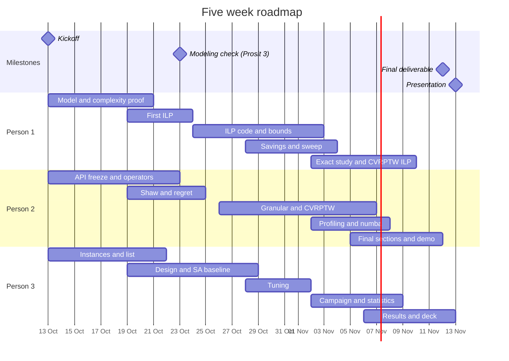

# Schedule

Five weeks, from the kickoff on **13 October 2026** to the ADEME submission. Dates of the modeling
check and of the presentation are **assumptions to confirm** at kickoff (D9).

## Week by week

| Week | Dates | Goal | Done when |
| --- | --- | --- | --- |
| 1 | 13 to 18 Oct | Lanes assigned; model and proof drafted; API frozen; instances downloaded | kickoff decisions closed; notation and proof drafts reviewed |
| 2 | 19 to 25 Oct | **Modeling deliverable**; new operators; instance list and design final | tutor check passed; 20 plus instances in `config.yaml` |
| 3 | 26 Oct to 1 Nov | ILP running on small n; ALNS complete for CVRP; first gaps on A and X | gap table for A instances in the weekly meeting |
| 4 | 2 to 8 Nov | Scaling and CVRPTW; full campaign; statistics | `results/` complete; notebook 03 draft |
| 5 | 9 to 13 Nov | Final notebook, deck, rehearsal | final deliverable handed in; presentation given |

## Weekly log

*Appended after each weekly meeting by the scribe.*

| Week | Done | Blocked | Decisions |
| --- | --- | --- | --- |
| 1 | | | |
| 2 | | | |
| 3 | | | |
| 4 | | | |
| 5 | | | |
