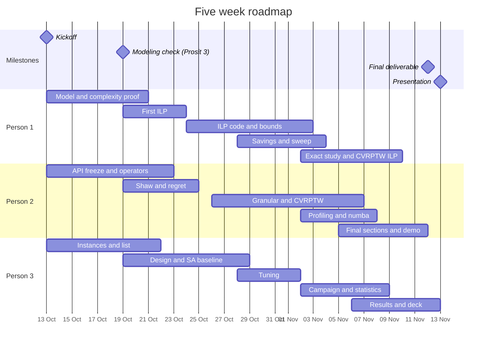

# Schedule

Five weeks, from the kickoff on **13 October 2026** to the ADEME submission. Dates of the modeling
check and of the presentation are **assumptions to confirm** at kickoff (D9).

## Week by week

| Week | Dates | Goal | Done when |
| --- | --- | --- | --- |
| 1 | 13 to 18 Oct | Lanes assigned; model and proof drafted; API frozen; instances downloaded | kickoff decisions closed; notation and proof drafts reviewed |
| 2 | 19 to 25 Oct | **Modeling deliverable**; new operators; instance list and design final | tutor check passed; 20 plus instances in `config.yaml` |
| 3 | 26 Oct to 1 Nov | ILP running on small n; ALNS complete for CVRP; first gaps on A and X | gap table for A instances in the weekly meeting |
| 4 | 2 to 8 Nov | Scaling and CVRPTW; full campaign; statistics | `results/` complete; notebook 03 draft |
| 5 | 9 to 13 Nov | Final notebook, deck, rehearsal | final deliverable handed in; presentation given |

## Final sprint, 10 to 13 November

The professor reviewed our progress on **10 November** (notes taken by Pablo). What he asks, and
what we have now:

| # | Request | Have now | Gap to close |
| --- | --- | --- | --- |
| R1 | At least **10 000 customers** | 100 (Solomon), 31 (A, B) | scale study up to 10 000 |
| R2 | Synthetic or random graphs | uniform generator only | uniform, clustered, random graph |
| R3 | **Real graphs**: OpenStreetMap, NetworkX | none | road network travel times |
| R4 | Compare two countries, **France and Egypt**: why better in one, why in the other | none | same protocol in both, network metrics, explanation |
| R5 | Performance against **intrinsic parameters** (as pheromones for Ant Colony), "to the maximum" | one tuning grid per algorithm | sensitivity curves per parameter, behavior measures |
| R6 | **Our own analysis and opinion**: which algorithm in every scenario | one winner overall | recommendation per scenario, written by us |
| R7 | **No code** in the presentation | deck not started | slides with mathematics, figures, conclusions |
| R8 | Real world shows the **limit** of the algorithm: understand it | 100 customers only | largest n that works, time, memory, where quality breaks |
| R9 | **What happens during the night?** | traffic factor 1 at night, 48 h horizon | night against morning departure, with numbers |

R9 has two readings: the traffic at night (our reading), or what an algorithm gains when it runs
all night. The plan covers both (task P3 and the overnight long runs); Pablo confirms with the
professor.

### Timeline

Everything is finished on **11 November at night**; 12 November is hand in, rehearsal and buffer.

| When | Who | What |
| --- | --- | --- |
| 10 Nov 11:00 | all | 30 min call: agree on this plan, the two cities, the time budgets |
| 10 Nov 11:30 to 16:00 | all | sensitivity study of your own algorithm on the 6 Solomon tuning instances |
| 10 Nov by 14:00 | Pablo | scale harness ready, smoke test at n = 1 000 with one command |
| 10 Nov 14:00 to 20:00 | Farida, Pablo | GRASP-ILS and Tabu Search run at 1k, 2k, 5k, 10k customers |
| 10 Nov 14:00 to 18:00 | Dag | SA run at 1k, 2k, 5k, 10k with the harness command; report where it stops |
| 10 Nov 14:00 to 20:00 | Pablo | France and Egypt instances, network metrics, traffic profiles, night experiment |
| 10 Nov 20:00 | all | freeze: every algorithm passes the 10 000 smoke test |
| 10 Nov 21:00 to 11 Nov 07:00 | Pablo's M2 | overnight campaign and one long run per algorithm |
| 11 Nov 09:00 | all | results meeting: scenario table, story of the deck |
| 11 Nov 09:00 to 12:00 | all | analysis paragraph of your own algorithm and its 2 slides |
| 11 Nov 09:00 to 15:00 | Pablo | final notebook, docs, live demo |
| 11 Nov 09:00 to 16:00 | Farida | deck, no code |
| 11 Nov 16:00 | all | deck v1 complete; professor agent review |
| 11 Nov 20:00 | all | rehearsal 1, timed, with question drill |
| 12 Nov | all | hand in, rehearsal 2, buffer |
| 13 Nov | all | presentation |

### Tasks and deliverables

Each person keeps their lane: the harness is shared, each algorithm is studied by its author.

| ID | Owner | Task | Deliverable | Due |
| --- | --- | --- | --- | --- |
| P1 | Pablo | Instance builders (uniform, clustered, random graph with NetworkX, OpenStreetMap city with osmnx), travel times by shortest paths (scipy), network metrics, Belgium set (CVRPLIB), `experiments/scale_study.py` with the `ALGORITHMS` hook, matrices memory mapped (8 GB of RAM) | `src/cvrp/graphs.py`, `experiments/scale_study.py`, one command smoke test | 10 Nov 14:00 |
| P2 | Pablo | Tabu Search at 10 000; sensitivity of tenure, candidate list, neighbor list | scale table, sensitivity CSV and curves | 10 Nov 20:00 |
| P3 | Pablo | France and Egypt (proposal: Lyon and Cairo): metrics, traffic profile, departure 8:00 against 22:00 | instances, metrics table, night table | 10 Nov 20:00 |
| P4 | Pablo | Final notebook and docs; SA adapter for the scale harness; live demo (outputs only) | notebook executed, docs build, demo | 11 Nov 15:00 |
| D1 | Dag | Run SA at 1k, 2k, 5k, 10k with the P1 command; the size where it fails is the measured limit | table of n, time, peak memory, largest n that works | 10 Nov 18:00 |
| D2 | Dag | SA sensitivity of $f$ and $T_f$, 3 seeds, one curve each | CSV and 2 curves, one sentence each | 10 Nov 16:00 |
| D3 | Dag | SA analysis paragraph and 2 SA slides | text, slides | 11 Nov 12:00 |
| F1 | Farida | GRASP-ILS at 1k, 2k, 5k, 10k (granular insertion candidates in the construction) | GRASP-ILS in `ALGORITHMS`, same table as D1 | 10 Nov 20:00 |
| F2 | Farida | GRASP-ILS sensitivity: $\alpha$, kicks, kick size, neighbor list; iterations against $\alpha$ | CSV and curves, one sentence each | 10 Nov 16:00 |
| F3 | Farida | Deck without code; GRASP-ILS analysis paragraph | deck v1 | 11 Nov 16:00 |

Sensitivity rule: one factor at a time around the tuned value, the 6 tuning instances, at least 3
seeds, 20 s per run, mean gap with its spread, one sentence per curve, plus one behavior measure.

### Scale campaign protocol (overnight)

| Item | Value |
| --- | --- |
| Problem | CVRP (capacity) with travel times; duration with traffic for the night study only |
| Synthetic | uniform and clustered points, n = 1 000, 2 000, 5 000, 10 000 |
| Real roads | France and Egypt cities, n = 1 000, 5 000, 10 000 customers on road nodes |
| With best known value | Belgium set: Leuven1 (3 000), Antwerp1 (6 000), Ghent1 (10 000) |
| Budget | 0.06 s per customer: 60 s at 1 000, 600 s at 10 000, the same for every algorithm |
| Seeds | 3 (5 if the night allows) |
| Metric | gap to the best known value (Belgium); elsewhere deviation to the best solution of any run; time to the first feasible solution; peak memory |
| Parallel | 7 runs below 5 000 customers, 3 at 5 000 and above (memory) |
| Tests | Friedman, then Wilcoxon with Holm, as in section 8 |
| Size | about 13 worker hours for 3 seeds: about 3.5 h of wall clock |

### Scenario recommendation (to fill on 11 November, 09:00)

| Scenario | Recommended | Why (number from our data) |
| --- | --- | --- |
| up to 8 customers, with traffic | exact ILP | |
| 100 customers, clustered, tight windows | | |
| 100 customers, random or mixed, long routes (type 2) | | |
| 1 000 to 10 000 customers | | |
| real road network, France | | |
| real road network, Egypt | | |
| short time budget | | |
| night departure | | |

### Definition of done

- Every new table or figure has one sentence that says what it means.
- Every claim of the analysis cites a number of this project.
- The professor agent (`.claude/agents/professor.md`) returns no BLOCKING item.

## Weekly log

*Appended after each weekly meeting by the scribe.*

| Week | Done | Blocked | Decisions |
| --- | --- | --- | --- |
| 1 | | | |
| 2 | | | |
| 3 | | | |
| 4 | | | |
| 5 | | | |
