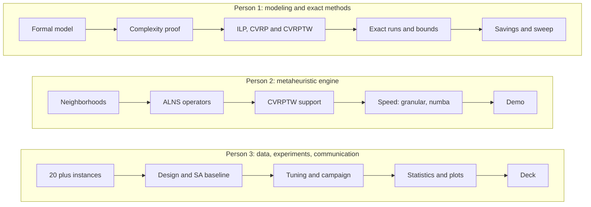

# Task separation

How the project splits across three people. The split follows the three things the final grade
looks at: **a correct model** (Person 1), **a solver that finds good solutions fast** (Person 2),
and **evidence that it does** (Person 3). Each lane owns its code, its notebook sections and its
documentation pages, so two people never edit the same thing at the same time.

:::tip[Decide at today's kickoff]
The names are not assigned yet: we pick who takes which lane in the
[kickoff meeting](./management/kickoff-meeting.md). Write the result here.

| Lane | Person | Name |
| --- | --- | --- |
| Modeling and exact methods | Person 1 | _to assign_ |
| Metaheuristic engine | Person 2 | Dagmawi |
| Data, experiments and communication | Person 3 | _to assign_ |

:::

## The three lanes at a glance

| | Person 1 | Person 2 | Person 3 |
| --- | --- | --- | --- |
| **Owns (code)** | `ilp.py`, `construct.py` (savings, sweep) | `neighborhoods.py`, `alns.py`, `timewindows.py` | `instance.py` loaders, `sa.py`, `experiments/`, `viz.py` |
| **Owns (notebooks)** | `01_modeling_check`, final sections 1 to 4 | final sections 5 to 7 | `03_experimental_study`, final section 8 |
| **Owns (docs)** | Discovery, Technical: modeling, complexity, ILP | Technical: metaheuristic, architecture | Experimentation, Delivery: presentation plan |
| **Reviews** | Person 2's pull requests | Person 3's pull requests | Person 1's pull requests |
| **Main risk** | ILP too slow beyond n = 15 | Gap above 7 percent on X instances | Fewer than 20 instances ready in time |

Shared by all three: the final notebook section 9 (limitations), the presentation and its
rehearsal, the [checklist](./delivery/checklist.md), and one role each in the
[weekly meeting](./management/working-agreements.md#meeting-roles).

## Person 1: modeling and exact methods

Turns the business problem into mathematics, proves it is hard, and solves small cases exactly so
everyone else has optimal answers to compare against. Owns the first deliverable.

| ID | Task | Week | Depends on | Output |
| --- | --- | --- | --- | --- |
| P1-01 | Formal data representation, notation table (CVRP then CVRPTW) | 1 | | `technical/modeling.md`, notebook 01 section 2 |
| P1-02 | Problem and objective statement; traffic per time slot as an extension | 1 | P1-01 | notebook 01 section 3 |
| P1-03 | Complexity proof: Hamiltonian cycle to TSP to CVRP, then CVRPTW | 1 to 2 | P1-01 | `technical/complexity.md`, notebook 01 section 5 |
| P1-04 | First ILP: two-index with MTZ, then time windows with big-M | 2 | P1-01 | `technical/ilp-model.md`, notebook 01 section 6 |
| P1-05 | **Modeling deliverable check with the tutor** | 2 | P1-01 to P1-04 | notebook 01 validated |
| P1-06 | Implement `solve_cvrp_mtz` with PuLP and CBC; decode routes | 2 to 3 | P1-04 | `src/cvrp/ilp.py`, tests on n up to 12 |
| P1-07 | LP relaxation lower bound; optional rounded capacity cuts | 3 | P1-06 | `ILPResult.lower_bound` |
| P1-08 | Exact approach study: solve time against n, where it stops being usable | 3 to 4 | P1-06, P3-02 | final notebook section 4 |
| P1-09 | Implement `solve_cvrptw` | 4 | P1-06 | `src/cvrp/ilp.py` |
| P1-10 | Clarke and Wright savings and sweep constructions | 3 to 4 | | `src/cvrp/construct.py` |
| P1-11 | Apply tutor feedback to the model for the final deliverable | 4 | P1-05 | final notebook sections 1 to 3 |
| P1-12 | Bibliography: verify every entry and mark it checked | 1 to 5 | | `reference/bibliography.md` |

## Person 2: metaheuristic engine

Builds the solver that handles realistic sizes (thousands of customers for CVRP) with a gap below
7 percent. Owns the algorithm description and the implementation sections of the final deliverable.

| ID | Task | Week | Depends on | Output |
| --- | --- | --- | --- | --- |
| P2-01 | Freeze the `Instance` and `Solution` API with Person 3 (shared contract) | 1 | | `instance.py`, `solution.py` |
| P2-02 | Swap, Or-opt and cross-exchange operators, vectorized | 1 to 2 | P2-01 | `neighborhoods.py`, tests |
| P2-03 | Shaw (related) removal and regret-k insertion | 2 | | `alns.py`, tests |
| P2-04 | Write the metaheuristic design: encoding, neighborhoods, operators, guidance | 2 | | `technical/metaheuristic.md` |
| P2-05 | First full run on Augerat A and X up to n = 200; first gap numbers | 2 to 3 | P3-01 | numbers for the weekly meeting |
| P2-06 | Granular neighborhoods (k nearest neighbors) so relocate and insertion scale | 3 | P2-02 | `neighborhoods.py` |
| P2-07 | Forward time slack and CVRPTW aware insertion and moves | 3 to 4 | | `timewindows.py`, `alns.py` |
| P2-08 | Profiling; numba on the hot loops if needed; target X up to n = 1000 | 4 | P2-06 | timings in `technical/architecture.md` |
| P2-09 | Final notebook sections 5 to 7: method, implementation, test cases, demo | 4 to 5 | | notebook 02 |
| P2-10 | Live demo script for the presentation (small instance, under one minute) | 5 | P2-09 | `notebooks/02` demo cell |

## Person 3: data, experiments and communication

Makes the results trustworthy and the story clear: instances, runs, statistics, figures and the
presentation. Owns the experimental study and keeps the documentation site in shape.

| ID | Task | Week | Depends on | Output |
| --- | --- | --- | --- | --- |
| P3-01 | Download Augerat A, B, P, Uchoa X, Solomon, Homberger; record URLs | 1 | | `data/`, `data/README.md` |
| P3-02 | Final list of at least 20 instances covering every scenario | 1 to 2 | P3-01 | `experimentation/instances.md`, `config.yaml` |
| P3-03 | Instance loaders: depot reordering, Solomon best known values, mixed (RC) generator | 2 | P3-01 | `instance.py` |
| P3-04 | Experimental design: questions, factors, metrics, tests, seeds, time budget | 2 | | `experimentation/experimental-design.md` |
| P3-05 | Plain simulated annealing baseline (reuses `sa.accept`) | 2 to 3 | | `sa.py` |
| P3-06 | Parameter tuning on a separate tuning set (no test instance used for tuning) | 3 | P2-03, P3-02 | `config.yaml` |
| P3-07 | Full benchmark campaign: all instances, 10 seeds, recorded hardware | 4 | P3-06 | `results/*.csv` |
| P3-08 | Statistics and figures: gap boxplots, time scaling, Wilcoxon or Friedman with Holm | 4 | P3-07 | `experiments/analyze.py`, notebook 03 |
| P3-09 | Results page and final notebook section 8 | 4 to 5 | P3-08 | `experimentation/results.md` |
| P3-10 | Presentation deck in English, timing, rehearsal | 5 | all | `delivery/presentation-plan.md` |

## Interfaces between lanes

Three contracts keep the lanes independent. Changing one needs the other owner's review.

1. **`Instance` and `Solution`** (P2-01, with Person 3): field names, node 0 is the depot, routes
   exclude the depot. Frozen at the end of week 1.
2. **Algorithm signature** (Person 2 to Person 3): every solver is
   `f(inst, params, seed) -> Solution` plus traces; `run_benchmark.run_algorithm` dispatches by name.
3. **Results CSV schema** (Person 3): `instance, family, n, time_windows, algorithm, seed, cost,
   best_known, gap, seconds, routes, feasible`. Person 1's exact runs write the same columns.

## Already done by the scaffold

So nobody redoes it: `Instance` with VRPLIB and Solomon loaders and a random generator;
`Solution` with cost and full feasibility check; nearest neighbor; 2-opt and relocate; route
schedules and time window feasibility; a working ALNS with random and worst removal, greedy
insertion, adaptive weights and SA acceptance; the benchmark harness; the analysis script; the
notebooks' skeletons; CI with ruff and pytest.
