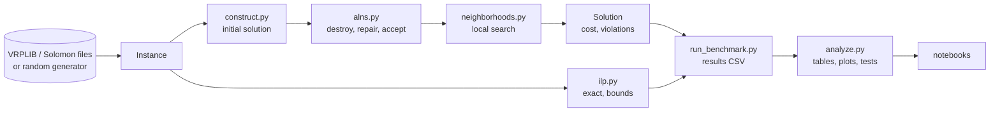

# Code architecture

Owner: **Person 2** (keeps this page in sync with the code). How the package is organized, what
each module does, and what is implemented today.

## Data flow

## Modules

| Module | Responsibility | Status | Lane |
| --- | --- | --- | --- |
| `instance.py` | `Instance` dataclass, VRPLIB and Solomon loaders, random generator | implemented; depot reordering and mixed generator TODO | Person 3 |
| `solution.py` | `Solution` (list of routes), cost, loads, full constraint check | implemented | Person 2 |
| `utils.py` | Distance matrix (numpy broadcast, rounding conventions), RNG, timer, gap | implemented | shared |
| `construct.py` | Nearest neighbor, Clarke and Wright, sweep | NN implemented; others TODO | Person 1 |
| `neighborhoods.py` | 2-opt, relocate, swap, Or-opt, cross-exchange, VND driver | 2-opt, relocate, driver implemented | Person 2 |
| `alns.py` | ALNS engine, destroy and repair operators | engine, random, worst, greedy implemented | Person 2 |
| `sa.py` | SA acceptance helpers, plain SA baseline | helpers implemented; baseline TODO | Person 3 |
| `timewindows.py` | Schedules, waiting, window feasibility, forward slack | schedule and feasibility implemented | Person 2 |
| `ilp.py` | MTZ CVRP and CVRPTW models with PuLP | TODO | Person 1 |
| `viz.py` | Route plots, convergence curves | implemented | Person 3 |

## Conventions

- **Node 0 is the depot.** Customers are 1 to n. Routes never contain 0.
- **Every stochastic function takes a seed or a `numpy.random.Generator`.** Same seed, same result
  (tested in `test_alns_smoke.py`).
- **Distances are precomputed** once in `Instance.dist`; nothing recomputes a square root inside a loop.
- **Hot paths are vectorized.** Deltas for all candidates are computed with numpy fancy indexing,
  then `argmin`. Python loops only remain over customers or routes, not over positions.
- **Style.** PEP 8 via `ruff` (line length 99), Google docstrings, type hints on every function.
- **TODO markers** name the lane: `TODO(Person 2): ...`. `grep -rn "TODO(Person" src` lists the work.

## Tests

| File | Covers |
| --- | --- |
| `tests/test_instance.py` | distance matrix, rounding, properties, VRPLIB loader, reproducible generator, gap |
| `tests/test_solution.py` | route cost, feasibility, violation messages, waiting, late arrival |
| `tests/test_neighborhoods.py` | NN feasibility, 2-opt, relocate, local search never worsens |
| `tests/test_alns_smoke.py` | full pipeline on a tiny instance, reproducibility, time windows |

## Performance log

To fill by Person 2 (P2-08): instance, n, seconds per 1000 ALNS iterations, before and after each
optimization.

| Change | X-n101 | X-n502 | X-n1001 |
| --- | --- | --- | --- |
| baseline (scaffold) | | | |
| granular neighborhoods | | | |
| numba | | | |
