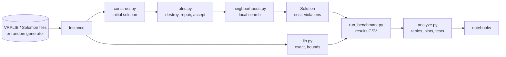

# Code architecture

Owner: **Person 2** (keeps this page in sync with the code). How the package is organized, what
each module does, and what is implemented today.

## Data flow

## Modules

| Module | Responsibility | Author |
| --- | --- | --- |
| `instance.py` | `Instance` dataclass, VRPLIB and Solomon loaders, random generator | shared |
| `solution.py` | `Solution` (list of routes), cost, loads, full constraint check (the shared evaluator) | shared |
| `utils.py` | Distance matrix (rounding conventions), RNG, timer, gap | shared |
| `ilp.py` | Exact models with PuLP and HiGHS: the model with traffic (`solve_tdvrptw`), CVRPTW, three CVRP formulations | Pablo |
| `construct.py` | Nearest neighbor, Clarke and Wright, sweep | Pablo |
| `tabu.py` | Tabu Search, route costs (distance, duration with traffic) | Pablo |
| `grasp.py` | GRASP and GRASP-ILS, the chosen method | Farida |
| `sa.py`, `sa_static.py`, `sa_vrptw.py`, `sa_protocol.py` | Simulated Annealing (compiled with numba) | Dag |
| `alns.py`, `neighborhoods.py`, `timewindows.py` | early scaffold (ALNS, moves, schedules), not used in the final study | shared |
| `viz.py` | Route plots, convergence curves | shared |

Experiments: `experiments/solomon_study.py` (tuning and benchmark of the three metaheuristics),
`experiments/solomon_report.py` (tables and tests), `experiments/exact_study.py` (exact approach).

## Conventions

- **Node 0 is the depot.** Customers are 1 to n. Routes never contain 0.
- **Every stochastic function takes a seed or a `numpy.random.Generator`.** Same seed, same result
  (tested in `test_alns_smoke.py`).
- **Distances are precomputed** once in `Instance.dist`; nothing recomputes a square root inside a loop.
- **Hot paths are vectorized.** Deltas for all candidates are computed with numpy fancy indexing,
  then `argmin`. Python loops only remain over customers or routes, not over positions.
- **Style.** PEP 8 via `ruff` (line length 99), Google docstrings, type hints on every function.

## Tests

`pytest` runs 76 tests: the shared evaluator (`test_solution.py`), the loaders (`test_instance.py`),
the exact models including the toy optimum of notebook 01 (`test_ilp.py`), and each metaheuristic
(`test_tabu.py`, `test_grasp.py`, `test_sa*.py`).
