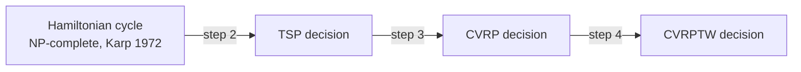

# Complexity

Owner: **Person 1**. Goal: prove the CVRP (and the CVRPTW) is NP-hard by polynomial reduction from
a known NP-complete problem. Feeds section 5 of notebook 01.

:::note[Proof skeleton]
The structure below is what we expect to present. Each step lists what must be written out in
full. Nothing here is a result until Person 1 completes it and the tutor validates it.

:::

## What we need to show

- **CVRP-DEC** (decision version): given an instance and a bound $B$, is there a feasible solution
  of cost at most $B$?
- **Claim:** CVRP-DEC is NP-complete, hence the optimization CVRP is NP-hard.

The chain of reductions:

## Step 1: CVRP-DEC is in NP

Certificate: a list of routes. Checking that each customer appears once, that each load is at most
$Q$, that there are at most $K$ routes and that the total cost is at most $B$ takes $O(n)$ time
(`Solution.violations` does exactly this). **TODO:** write formally.

## Step 2: Hamiltonian cycle reduces to TSP

Given a graph $H = (V, E)$ with $|V| = n$, build a complete graph with
$c_{ij} = 1$ if $\{i, j\} \in E$ and $c_{ij} = 2$ otherwise, and set $B = n$.
$H$ has a Hamiltonian cycle if and only if there is a tour of cost at most $n$.
The construction is $O(n^2)$. **TODO:** prove both directions.

## Step 3: TSP reduces to CVRP

Given a TSP instance (complete graph, costs $c_{ij}$, bound $B$), choose any node as the depot,
set $q_i = 1$ for each customer, $Q = n$ and $K = 1$. A single truck must visit every customer
and come back: CVRP solutions are exactly TSP tours, with the same cost. The construction is
linear. **TODO:** prove both directions; discuss that with free $K$ and triangle inequality an
optimal CVRP solution with $Q \ge n$ also uses one route.

Conclusion: CVRP-DEC is NP-complete; CVRP is NP-hard. The TSP is the special case, which is why
the class hypothesis "the cycle is a Hamiltonian cycle" is true only for $K = 1$.

## Step 4: CVRPTW is NP-hard

Every CVRP instance is a CVRPTW instance with windows $[0, +\infty)$ and $s_i = 0$, so the
CVRPTW generalizes the CVRP. Stronger, and worth citing: with a fixed number of vehicles, even
*finding a feasible* CVRPTW solution is NP-complete (Savelsbergh, 1985, *to verify*).

## Remark: capacity alone is already hard

Deciding whether $K$ trucks suffice to carry all demands is the bin packing decision problem,
which is strongly NP-complete (Garey and Johnson). So the CVRP is hard for two independent
reasons: routing (TSP) and packing (bin packing). **Optional** for the deliverable.

## What this means for the method

- No polynomial exact algorithm is known: hypothesis 2 of the class sheet is expected to be refuted.
- Exact ILP is usable only for small instances; [ILP model](./ilp-model.md).
- For realistic sizes we use a metaheuristic whose **iterations** are polynomial, and we measure
  quality with the gap and cost with the empirical time scaling.
