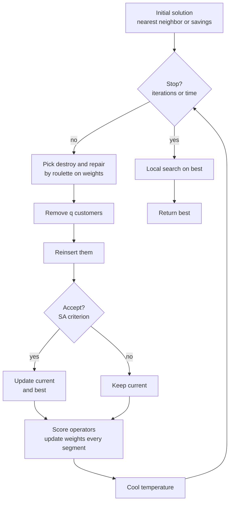

# Metaheuristic

Owner: **Person 2**. Feeds section 5 and 6 of the final deliverable. Code: `src/cvrp/alns.py`,
`neighborhoods.py`, `construct.py`, `sa.py`, `timewindows.py`.

## Choice: ALNS with simulated annealing acceptance

**Adaptive Large Neighborhood Search** (Ropke and Pisinger, 2006): at each iteration, *destroy*
part of the current solution (remove q customers), *repair* it (reinsert them), and accept or
reject the result. Several destroy and repair operators compete; the ones that produce good
solutions are chosen more often.

| Option considered | For | Against | Decision |
| --- | --- | --- | --- |
| **ALNS + SA acceptance** | Handles CVRP and CVRPTW with the same operators; large moves escape local optima; well documented; simple to implement | Many parameters | **Chosen** |
| Plain simulated annealing | Very simple | Small moves, slow on large instances | **Kept as baseline** (`sa.py`) |
| Tabu search | Strong on CVRP | Memory structures, tuning of tenure | Not chosen |
| Genetic algorithm or HGS | State of the art (HGS, Vidal 2022) | Much more complex to implement well in 5 weeks | Cited as the reference to compare against |

*To confirm at kickoff.* The choice is justified in the deliverable with this table.

## Solution encoding

A solution is a **list of routes**, each a Python list of customer indices without the depot:
`[[3, 1, 7], [5, 2], [4, 6]]`. Cost and feasibility are computed by `Solution.cost` and
`Solution.violations`.

Alternative, for the deliverable discussion: a **giant tour** (permutation of all customers) split
optimally into routes by the Split algorithm (Prins, 2004, *to verify*), as used by genetic
algorithms.

## Overall loop

## Operators

| Kind | Operator | Idea | Status |
| --- | --- | --- | --- |
| Construction | Nearest neighbor | Drive to the closest customer that still fits | implemented |
| Construction | Clarke and Wright savings | Merge routes by largest saving $c_{0i} + c_{0j} - c_{ij}$ | TODO P1-10 |
| Construction | Sweep | Sort by polar angle, cut by capacity | TODO P1-10 |
| Destroy | Random removal | Remove q random customers | implemented |
| Destroy | Worst removal | Remove customers whose removal saves most, randomized | implemented |
| Destroy | Shaw (related) removal | Remove customers close in space, demand and time | TODO P2-03 |
| Repair | Greedy insertion | Cheapest feasible position, one customer at a time | implemented |
| Repair | Regret-k insertion | Insert first the customer that loses most by waiting | TODO P2-03 |
| Local search | 2-opt (intra) | Reverse a segment of a route | implemented |
| Local search | Relocate (intra and inter) | Move one customer elsewhere | implemented |
| Local search | Swap | Exchange two customers | TODO P2-02 |
| Local search | Or-opt | Move a chain of 1 to 3 customers | TODO P2-02 |
| Local search | Cross-exchange | Swap two segments between routes | TODO P2-02 |

## Guidance mechanisms

**Adaptive weights.** Each operator $o$ has a weight $w_o$, chosen with probability
$w_o / \sum w$. Every segment of 100 iterations,

$$
w_o \leftarrow (1 - r)\, w_o + r\, \frac{\pi_o}{\theta_o}
$$

where $\pi_o$ is the score collected in the segment and $\theta_o$ the number of uses. Scores:
$\sigma_1 = 33$ for a new global best, $\sigma_2 = 9$ for a better current, $\sigma_3 = 13$ for an
accepted worse solution (Ropke and Pisinger values).

**Simulated annealing acceptance.** A candidate worse by $\Delta$ is accepted with probability
$e^{-\Delta / T}$. $T_0$ is set so that a solution 5 percent worse is accepted with probability
0.5; $T$ is multiplied by a cooling rate (0.99975) every iteration.

**Final local search.** The best solution is polished with relocate and 2-opt until no move
improves it.

## Parameters

| Parameter | Default | Meaning | Tuned by |
| --- | --- | --- | --- |
| `iterations` / `time_limit` | 5000 / none | stopping criterion | experimental design |
| `destroy_min`, `destroy_max` | 0.1, 0.3 | fraction of customers removed | P3-06 |
| `segment` | 100 | iterations between weight updates | fixed |
| `reaction` $r$ | 0.1 | weight update speed | P3-06 |
| `sigma` | (33, 9, 13) | operator scores | fixed |
| `worse_pct` | 0.05 | calibrates $T_0$ | P3-06 |
| `cooling` | 0.99975 | geometric cooling rate | P3-06 |

## Time windows

Every insertion and move is checked with `is_route_tw_feasible`, which simulates the route
($O(\text{route length})$). P2-07 replaces it with **forward time slack** (Savelsbergh, 1992) so
an insertion is checked in $O(1)$.

## Scaling to thousands of customers

- **Granular neighborhoods:** only consider inserting $u$ next to its $k$ nearest neighbors
  (Toth and Vigo, 2003), from $O(n)$ to $O(k)$ candidates per customer. P2-06.
- **Vectorized deltas:** every operator computes all candidate deltas with numpy in one shot.
- **numba (optional):** the schedule and delta loops are plain numeric code that
  `@numba.njit` compiles without changes (`pip install -e ".[fast]"`). Only after profiling. P2-08.
